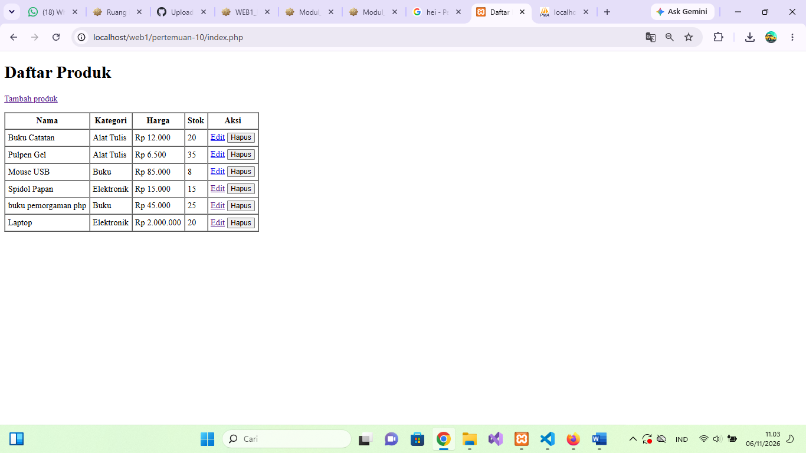
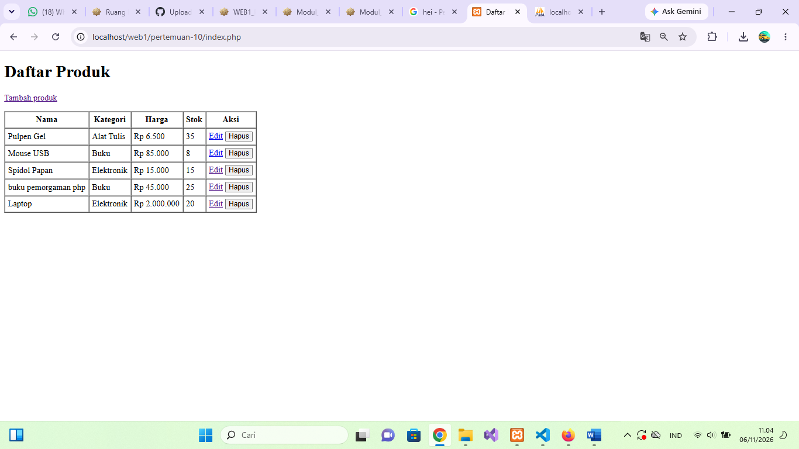

# Laporan Praktikum Pemrograman Web I - Modul 10

### Data Mahasiswa
* **Nama :** Andre Saputra Karona
* **NIM  :** 25012073
* **Kelas:** D3 Manajemen Informatika
* **Kampus:** Kampus 3 Politeknik Ganesha Medan

---

## DOKUMENTASI DAN BUKTI SCREENSHOT HASIL UJI CRUD

### 1. Bukti Tambah Produk Sukses
Berikut adalah bukti setelah produk baru berhasil ditambahkan ke dalam database dan muncul di tabel:

### 2. Bukti Ubah/Edit Data Sukses
Berikut adalah bukti setelah data produk berhasil diubah harganya atau stoknya:

### 3. Bukti Hapus Data Sukses
Berikut adalah bukti setelah produk uji coba berhasil dihapus dan menyisakan data bawaan modul:

---

## JAWABAN KUIS DAN REFLEKSI MODUL 10

**1. Mengapa data dari form dimasukkan melalui tanda `?` pada prepared statement?**
> **Jawab:** Tanda `?` bertindak sebagai *placeholder*. Tujuannya agar database bisa memeriksa struktur perintah SQL terlebih dahulu sebelum data asli dimasukkan. Hal ini mencegah input manipulatif dianggap sebagai perintah database, sehingga aman dari **SQL Injection**.

**2. Apa fungsi `WHERE id_produk = ?` pada UPDATE dan DELETE?**
> **Jawab:** Fungsinya sebagai kondisi pembatas agar operasi perubahan atau penghapusan data hanya berdampak pada **satu baris data yang spesifik** berdasarkan ID yang dipilih. Tanpa klausul `WHERE`, semua data di tabel akan ikut terubah atau terhapus.

**3. Mengapa `header()` dipanggil sebelum kode HTML?**
> **Jawab:** Karena `header()` memodifikasi HTTP header yang harus dikirim paling pertama ke browser sebelum konten utama (HTML/teks) dikeluarkan. Jika ada HTML yang keluar duluan, PHP akan memunculkan error *"Header already sent"*.

**4. Apa fungsi `mysqli_fetch_assoc()` pada halaman daftar?**
> **Jawab:** Fungsinya untuk mengambil hasil query database baris demi baris dan mengubahnya menjadi **Array Asosiatif** agar kita bisa memanggil datanya di HTML menggunakan nama kolom database langsung (seperti `$baris['nama_produk']`).

**5. Apa yang terjadi bila kategori yang dipilih tidak ada pada tabel kategori?**
> **Jawab:** Sistem validasi akan mendeteksi jumlah kategori bernilai `0`. Proses `INSERT` atau `UPDATE` akan dibatalkan, lalu memicu pesan kesalahan untuk mencegah kegagalan relasi (*foreign key error*) pada database.
